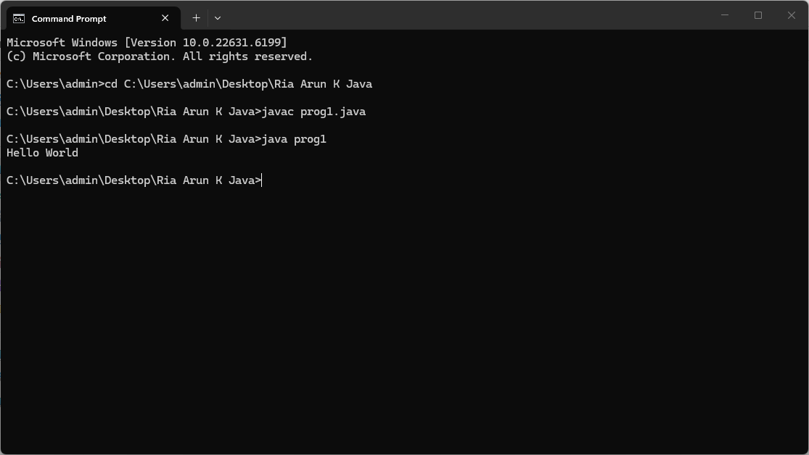
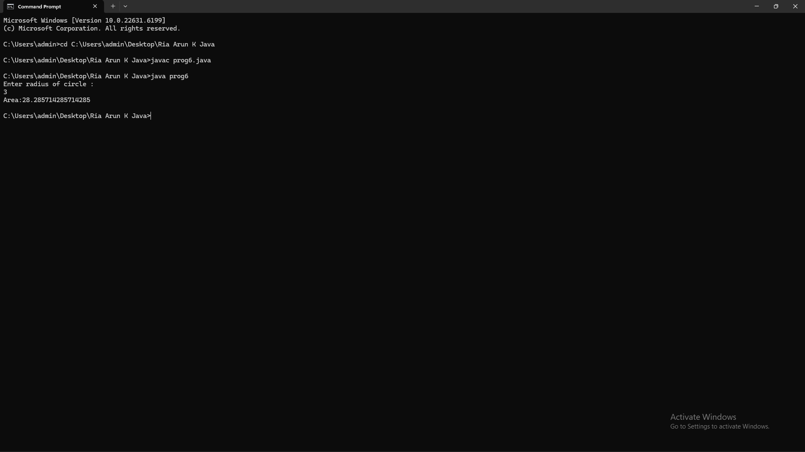
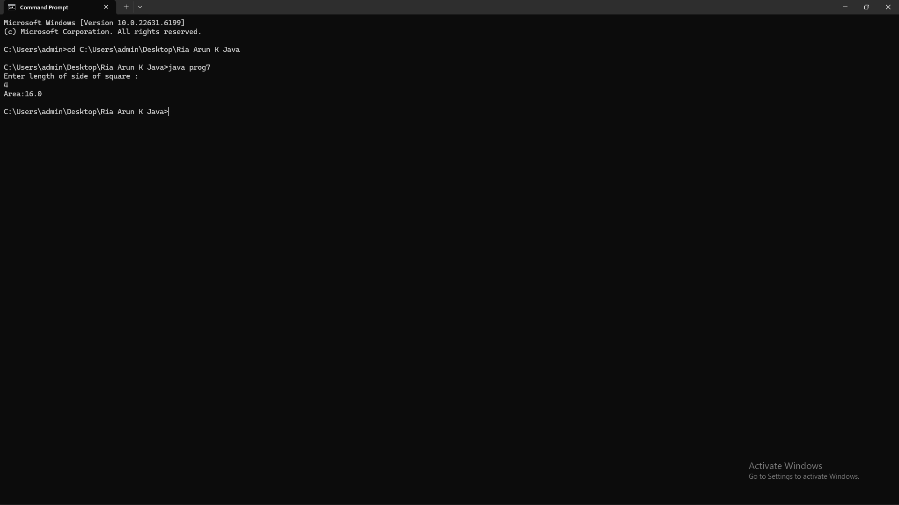
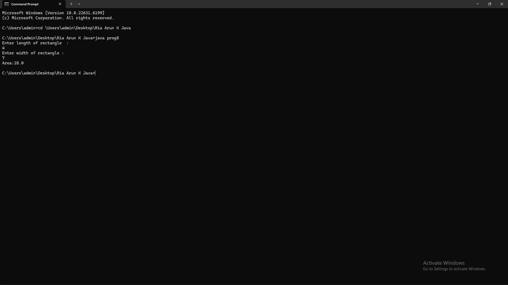
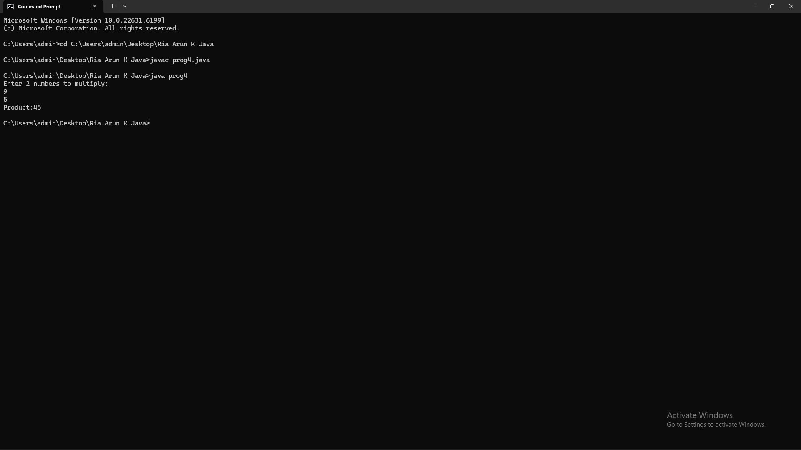
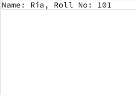
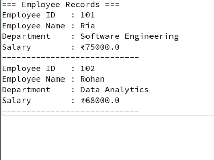
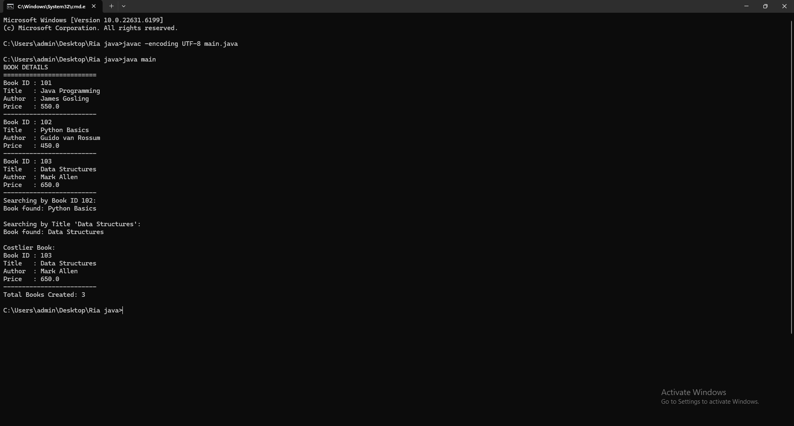

# Java Programming Lab Outputs

## Program 1

## Program 2

## Program 3

## Program 4

## Program 5

## Program 6

## Program 7

## Program 8

## Program 9

## Program 10

## Program 11

## Program 12

